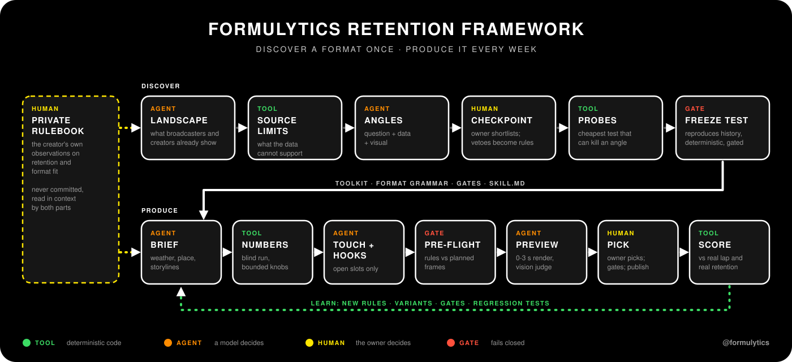
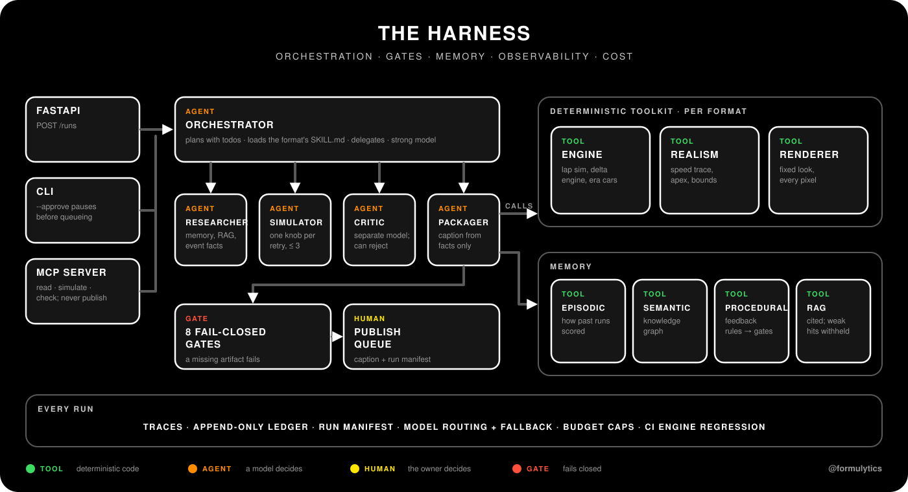

<p align="center">
  
</p>

<h1 align="center">Formulytics Retention Framework</h1>

<p align="center">
  <b>A framework for agents to produce content that holds attention, every week, from raw data.</b>
</p>

<p align="center">
  <a href="frameworks/DISCOVER.md">Discover</a> ·
  <a href="frameworks/PRODUCE.md">Produce</a> ·
  <a href="frameworks/SHARED.md">Core concepts</a> ·
  <a href="docs/HARNESS.md">Harness</a> ·
  <a href="frameworks/templates">Templates</a>
</p>

---

## Why

An agent can make one good video. It cannot, on its own, keep a format consistent, accurate and fresh every week.
Left alone it drifts: the look changes, numbers get invented, and every episode starts from zero. Meanwhile a
creator's hard-won knowledge of what holds attention is only applied after a post has already underperformed.

This framework fixes both. A format is discovered once and frozen into tools. Every event, agents fill a small set
of open slots with something new, the creator's own retention rules are checked **before** anything is rendered,
and every post is scored afterwards against reality and against real retention.

## How it works

<p align="center"></p>

**[Discover](frameworks/DISCOVER.md)** finds a format worth making. Agents map what already exists, prove what the
data can and cannot support, generate angles, and kill weak ones with cheap probes. The creator steers at two
checkpoints. A format leaves Discover only when it passes a freeze test.

**[Produce](frameworks/PRODUCE.md)** makes that format every event. The base is locked: engine, layout, palette,
motion, every number. Agents decide only what changes this week: a touch for an open slot and the hook. The plan is
checked against the creator's rulebook before rendering, a three-second preview is judged by a vision model, the
creator picks, and the post is scored and learned from.

## Core concepts

| Concept | What it is |
|---|---|
| **Format** | A frozen base plus a few open slots, each with a contract ([template](frameworks/templates/format.example.yaml)) |
| **Toolkit** | Deterministic tools that produce every number and every pixel. Agents never produce a number |
| **Rulebook** | The creator's own observations about retention, written as checkable rules. Private by design ([schema](frameworks/templates/rulebook.example.yaml)) |
| **Variant** | A reusable touch for an open slot, with its trigger and its track record ([template](frameworks/templates/variant.example.yaml)) |
| **Source card** | What a data source can and cannot support ([template](frameworks/templates/source_card.example.yaml)) |
| **Gate** | An automatic check that blocks publishing. Every gate started as recurring feedback |
| **Scene manifest** | The renderer's exact log of what is on screen, where and when, so rules can be checked before rendering |
| **Review packet** | The smallest preview a human needs to decide in under a minute |
| **Score** | Every post checked later against what happened and how the audience responded. Misses stay public |

One rule decides what goes to an agent: **if a rule can be written before seeing the input, it is a script. If it
can only be decided after seeing the input, it needs a model.**

## The harness

<p align="center"></p>

The framework runs on a purpose-built agent harness in [`factory/`](factory). An orchestrator delegates to
sub-agents with least-privilege tools. Fail-closed gates stand between the agents and the publish queue. Memory is
episodic, semantic, procedural and cited. Every run is traced, budgeted and recorded.
[Harness reference →](docs/HARNESS.md)

## Use it for your own content

| You bring | The framework gives you |
|---|---|
| Your data sources | Source cards, so data is never asked to do what it cannot |
| A toolkit for your format | The freeze test, gates, and the format grammar around it |
| Your own rulebook | A schema, and checks that run before rendering |
| Your taste at review time | Review packets, and a record of your picks that trains the judge |

Your rulebook stays yours. What holds attention differs by format and audience, so the repository ships the schema
with placeholder rules, never a real rulebook. Write your own from your own drafts and results.

## Reference deployment: Formulytics

The framework runs [Formulytics](https://www.instagram.com/formulytics/), a Formula 1 analytics channel with about
50K followers across Instagram and Facebook. Its videos regularly pass a million views, and the top reel reached
6.8 million.

| Format | Best reel |
|---|---|
| Optimal lap | [Watch](https://www.instagram.com/formulytics/reel/Da5omZXRHuT/) |
| Era comparison | [Watch](https://www.instagram.com/formulytics/reel/Dd96Pj0NA4T/) |
| Driver qualifying comparison | [Watch](https://www.instagram.com/formulytics/reel/DZQInymS2Ce/) |

[Results →](docs/RESULTS.md)

## Status

| Part | Status |
|---|---|
| Discover | In use for every format so far, steered by the creator |
| Produce: brief, numbers, gates, critic, captions, publish queue, run records, scoring | Running in the harness |
| Produce: format grammar, variant library, rulebook checks, preview judge, retention scoring | Specified, being built |
| Second domain | Cricket, planned on the same core |

## Quickstart

```bash
cd factory
python -m venv .venv && .venv/Scripts/pip install -r requirements.txt
cp .env.example .env                                   # OPENROUTER_API_KEY, LANGSMITH_API_KEY
docker compose up -d pgvector && python -m formulytics.rag ingest
python -m formulytics.run --weekend <event_id> --approve
```

## Repository

| Path | Contents |
|---|---|
| [`frameworks/`](frameworks) | The framework: Discover, Produce, core concepts, templates |
| [`factory/`](factory) | The harness that runs it |
| [`docs/`](docs) | Harness reference, results, diagrams |
| `OPTIMAL LAP SCRIPTS/` | Formulytics toolkits: simulators, renderers, delta engine |
