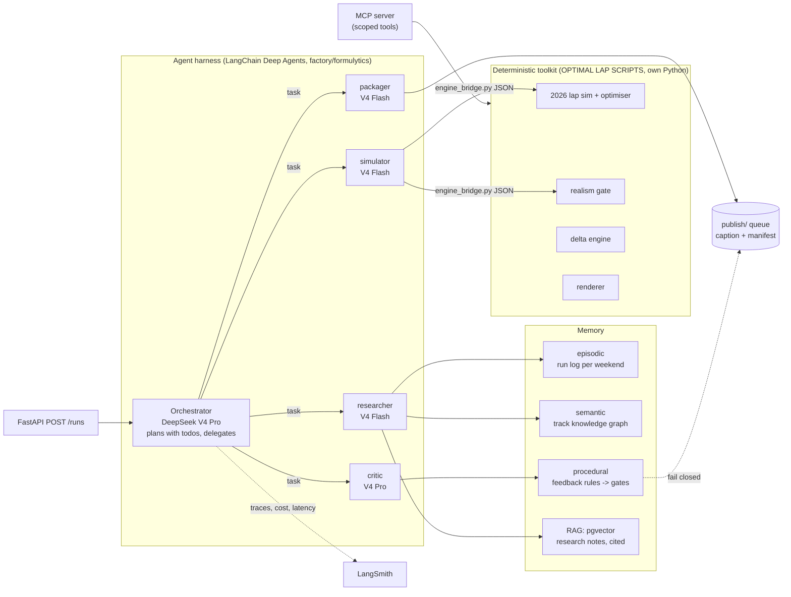

<p align="center">
  
</p>

<h1 align="center">Formulytics Content Factory</h1>

<p align="center"><b>An agentic content factory that turns low-quality public F1 data into engineering-accurate, viral content.</b><br>
It powers <a href="https://www.instagram.com/formulytics/">Formulytics</a>: about 50K followers across Instagram and Facebook, typically about 1M views per video, top video 10M.</p>

<p align="center">
  <br>
  <sub>Accuracy check: our delta-engine reconstruction (top) vs F1's official ghost-car onboard (bottom). Full clip: <a href="docs/media/ghostcar_validation.mp4">ghostcar_validation.mp4</a></sub>
</p>

---

## What it is

The agent starts from a goal: *data can be fun, so make data content that goes viral*. It
researched data sources, invented original formats, and built a **semi-deterministic
toolkit per format**: physics, a delta engine and a render style. The toolkit gives the page a
consistent structure and look. Every race weekend the factory fills that toolkit with live data and fresh research,
connects the dots, and produces the content.

Every output is judged on two axes:

1. **Engineering accuracy.** The input is a map-matched, low-rate public timing feed. The numbers have to survive
   comparison with what really happens on track.
2. **Engagement.** A hook that stops the scroll.

The human designed the harness and gave the early feedback. The agent turned that feedback into its own
**gates** (automated checks), and the human now only steps in occasionally, at the level of taste.

### Formats

| Format | What it is | Engine |
|---|---|---|
| **Optimal lap** | The fastest physically realistic 2026 lap of each track, simulated **before the cars run** (pre-FP1) from a track SVG | `OPTIMAL LAP SCRIPTS/sim_2026_lap.py`: energy-limited power unit, measured "superclip", active aero, grip map, min-curvature line optimiser |
| **Era comparison** | That lap vs a car from another era on the same track (2017 high-downforce, a legend's 2018 pole, 2025) | Era cars fitted to real telemetry, each on its own optimiser line; dual-video renderer |
| **Driver lap comparison** | Where pole gained on P2, metre by metre | `LAP COMPARISON/hifi_delta_v2.py`: delta engine validated against F1's ghost car (GIF above) |
| *Airflow / CFD (WIP)* | Ground-effect and wing airflow on track | Separate repo in progress (vortex-lattice, PteraSoftware) |

## Does it work? Predictions vs reality

Every shipped 2026 prediction, scored against what really happened. Real laps are pulled from OpenF1 by
[`factory/evals/build_golden.py`](factory/evals/build_golden.py). A dry simulation is only compared with a dry lap.

| Weekend | Data seen before shipping | Our lap | Real lap | Reference | Error |
|---|---|---|---|---|---|
| **São Paulo** | none (pre-FP1) | 1:10.772 | 1:10.763 | fastest dry lap of the weekend (FP2); qualifying was wet (pole 1:27.470) | **+0.009 s** |
| **Mexico City** | none (pre-FP1) | 1:16.758 | 1:16.514 | qualifying pole | **+0.244 s** |
| Silverstone | FP1 | 1:27.970 | 1:28.111 | qualifying pole | −0.141 s |
| Monaco | FP1 | 1:11.770 | 1:12.051 | qualifying pole | −0.281 s |
| Madring | FP1 + FP2 | 1:32.363 | 1:31.824 | qualifying pole | +0.539 s |
| Singapore | none (pre-FP1) | 1:33.010 | 1:31.373 | qualifying pole | +1.637 s |
| Spa | none (pre-FP1) | 1:41.910 | 1:44.361 | qualifying pole | −2.451 s |
| Sepang | none, and no 2025 reference either | 1:31.838 | 1:35.130 | qualifying pole | −3.292 s |
| Bahrain | none (pre-FP1) | 1:32.186 | — | race cancelled | — |

The method improved over the season. The current pre-FP1 method (measured superclip shape, altitude
power derate, fitted grip map; Mexico onward) lands within **0.25 s with zero 2026 running on the track**. The earlier
pre-FP1 tracks missed by 1.6–3.3 s, and those misses are what drove the method changes.

---

## Architecture



| Component | Where | What it actually does |
|---|---|---|
| **Multi-agent orchestration** | [`agents.py`](factory/formulytics/agents.py) | Deep Agents orchestrator (planning with todos, `task` delegation, context summarisation) + 4 least-privilege sub-agents; each sub-agent only gets the tools for its job |
| **Skills** | [`factory/skills/`](factory/skills) | One `SKILL.md` per format (optimal lap, era comparison, driver comparison, CFD WIP), loaded on demand |
| **Tools / tool calling** | [`tools.py`](factory/formulytics/tools.py), [`engine_bridge.py`](factory/engine_bridge.py) | Existing physics, delta and render scripts wrapped as typed tools; the engine runs in its own interpreter over a JSON bridge |
| **MCP** | [`mcp_server.py`](factory/formulytics/mcp_server.py) | FastMCP server exposing the toolkit to any MCP client; scoped to read, simulate and check (no publishing) |
| **Guardrails** | [`gates.py`](factory/formulytics/gates.py) | 8 gates from human feedback ([rules](factory/memory/procedural/feedback_rules.md)), fail closed; a claims gate blocks any caption number not in the run's verified facts; physical bounds on knobs; sandboxed filesystem (writes only to its own run folder) |
| **Human in the loop** | `--approve` | Optional taste approval: Deep Agents `interrupt_on` pauses before publishing |
| **Evals** | [`evals/`](factory/evals) | Golden dataset vs real results, deterministic engine regression (CI), memory-recall eval, retrieval hit@k + off-topic rejection, LLM-as-judge for captions, LangSmith experiment |
| **RAG** | [`rag.py`](factory/formulytics/rag.py) | pgvector (Docker) + local bge-small embeddings over design docs and calibration logs; every passage carries its source file; weak matches are withheld (threshold calibrated on off-topic probes) |
| **Memory** | [`memory.py`](factory/formulytics/memory.py) | Episodic (run log per weekend), semantic (track knowledge graph with multi-hop recall), procedural (feedback -> gates); in-run compaction via Deep Agents summarisation |
| **Observability & cost** | [`llm.py`](factory/formulytics/llm.py), [`ledger.py`](factory/formulytics/ledger.py) | LangSmith traces; per-call tokens, cached tokens, billed USD and latency; per-run and total budget caps that stop the run; append-only JSONL audit ledger |
| **Model routing** | [`config.py`](factory/formulytics/config.py) | Pro for planning and judging, Flash for workers, automatic fallback chain; any OpenRouter model is a one-line change |
| **Production** | [`api.py`](factory/formulytics/api.py), [`docker-compose.yml`](factory/docker-compose.yml), [CI](.github/workflows/factory-ci.yml) | FastAPI service, Docker Compose (API + pgvector), GitHub Actions (pytest + engine regression), versioned manifest per output |

---

## Demo: São Paulo 2026 replay

A full replay of the São Paulo weekend as it stood **before FP1**. During the run the agents can't see any
real result from that weekend; the score against reality is computed only after they finish.

```text
python -m formulytics.run --weekend sao_paulo_2026
```

| | Run 2 ([manifest](factory/runs/20261116-025039-bcad/manifest.json), [ledger](factory/runs/20261116-025039-bcad/ledger.jsonl)) |
|---|---|
| Agents | orchestrator -> researcher -> simulator -> critic (**APPROVE**) -> packager -> gates -> `publish/` |
| Model calls | 30 (14 V4 Pro, 16 V4 Flash); most prompt tokens are cache hits |
| Cost / time | **$0.047 billed**, 152 s wall |
| Lap | **1:10.772**: 9/9 engine realism checks, speed-trace corr 0.98 vs the real 2025 pole trace, 11/12 apexes within 1.5 m of the kerb |
| Gates | 8/8 pass |
| Caption | *"0.973s slower than 2025 pole — and that's fast"* (claims gate forced rewrites until every number traced to a fact) |
| Score vs reality (post-hoc) | +0.009 s vs the fastest dry lap of the weekend (qualifying was wet) |

<p align="center">
  <br>
  <sub>The run in LangSmith (trajectory view): the orchestrator reads the optimal-lap skill, writes its todo plan, then delegates to the
  researcher, simulator, critic and packager sub-agents and finishes with <code>run_all_gates</code> and <code>queue_for_publish</code>.
  2 min 32 s, 521 traced runs.</sub>
</p>

**The eval loop caught a real failure.** Run 1 ([manifest](factory/runs/20261116-024353-cbb0/manifest.json))
passed every gate but its caption said "this 7-corner circuit". The 7 is the number of
*calibration* corners; Interlagos has 15 turns. The claims gate only checked numbers with two or more digits, so it missed
it. The LLM judge scored that caption accuracy 1/5 and flagged exactly this. Fix: the gate now checks every number,
the caption is a regression test, and the post is marked [retracted](factory/publish/20261116-024353-cbb0/RETRACTED.md),
not deleted. A second leak was found the same way: episodic memory exposed run 1's real-world score to the
critic in a replay. Agents no longer see post-hoc scores.

### Eval results ([report](factory/evals/report.html), [raw](factory/evals/results.json))

| Eval | Result |
|---|---|
| Predictions vs reality (8 scored weekends) | MAE 1.07 s overall, 1.53 s pre-FP1, **0.13 s with the current method** |
| Engine regression (CI) | Shipped lap reproduced exactly (Δ 0.000 s), realism gate passes |
| Memory recall | 6/6 facts recovered from the track graph |
| Retrieval | hit@4 = 0.83 (miss: the apex rule query ranks a calibration log first); 3/3 off-topic queries withheld |
| Caption judge (V4 Pro) | Run 2: hook 5, accuracy 5, clarity 4, compliance 5. Run 1: accuracy 1 (caught the false claim) |
| Unit tests | 22 pass: every gate has a passing and a failing case, plus budget cap, ledger, API |
| LangSmith | Traces per run (project `formulytics-factory`); golden set uploaded as dataset `formulytics-golden-2026` with an experiment scoring the shipped predictions |

---

## Run it

```bash
cd factory
python -m venv .venv && .venv/Scripts/pip install -r requirements.txt   # harness, Python 3.11
pip install -r requirements-engine.txt                                   # engine, Python 3.10 (set ENGINE_PYTHON)
cp .env.example .env                                                     # OPENROUTER_API_KEY, LANGSMITH_API_KEY
docker compose up -d pgvector && python -m formulytics.rag ingest

python -m formulytics.run --weekend sao_paulo_2026            # full agent run
python -m formulytics.run --weekend sao_paulo_2026 --approve  # with human approval before publish
python evals/run_evals.py --langsmith                         # eval suite -> evals/report.html
python -m formulytics.mcp_server                              # toolkit as an MCP server
uvicorn formulytics.api:app                                   # POST /runs
pytest -q
```

Outputs land in the `publish/` queue with caption, tags and a manifest. Distribution runs outside this repo.

## Repository map

| Path | Contents |
|---|---|
| `factory/` | The agent harness, evals, memory, skills, API, MCP server |
| `OPTIMAL LAP SCRIPTS/` | The deterministic toolkit: 2026 lap simulator, line optimisers, realism gate, renderers, per-track calibration logs |
| `OPTIMAL LAP SCRIPTS/LAP COMPARISON/` | Delta engine and driver comparison |
| `OPTIMAL LAP SCRIPTS/cache/era2017/` | Era cars fitted to real telemetry, dual-video renderer |
| `launch_control_auto_car_rig/`, `F1_Pipeline_Assets/` | The Blender pipeline the early videos were made with ([its docs](docs/BLENDER_PIPELINE.md)) |
| `docs/media/` | Logo, ghost-car validation |

## Roadmap

Not built yet:

- **More weekends in the harness.** Only São Paulo is configured as a toolkit (`factory/weekends/`); the
  other tracks still run through their `make_*_2026_lap.bat` scripts. Next: generate the toolkit specs from those scripts.
- **Era and driver-comparison runs through the agents.** Their engines and skills exist; the tools are wired
  for the optimal lap only.
- **Rendering inside the run.** `engine_bridge.py render` exists, but the demo run doesn't render the video.
- **Regulations and papers in the RAG corpus.** Today it covers the project's own design docs and calibration logs.
- **Airflow / CFD format** (separate repo, work in progress).
