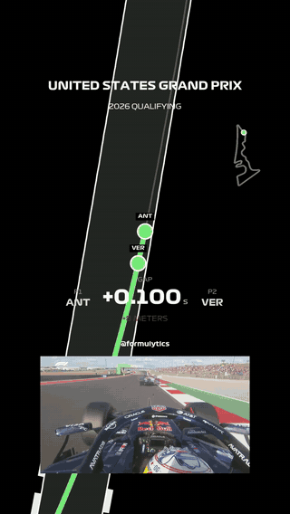
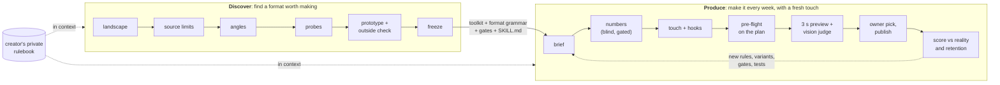
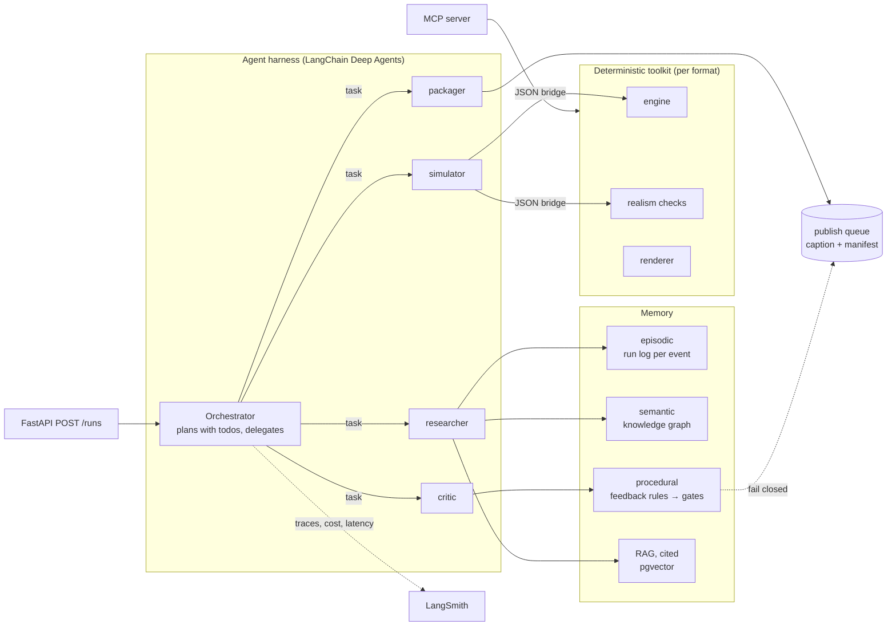
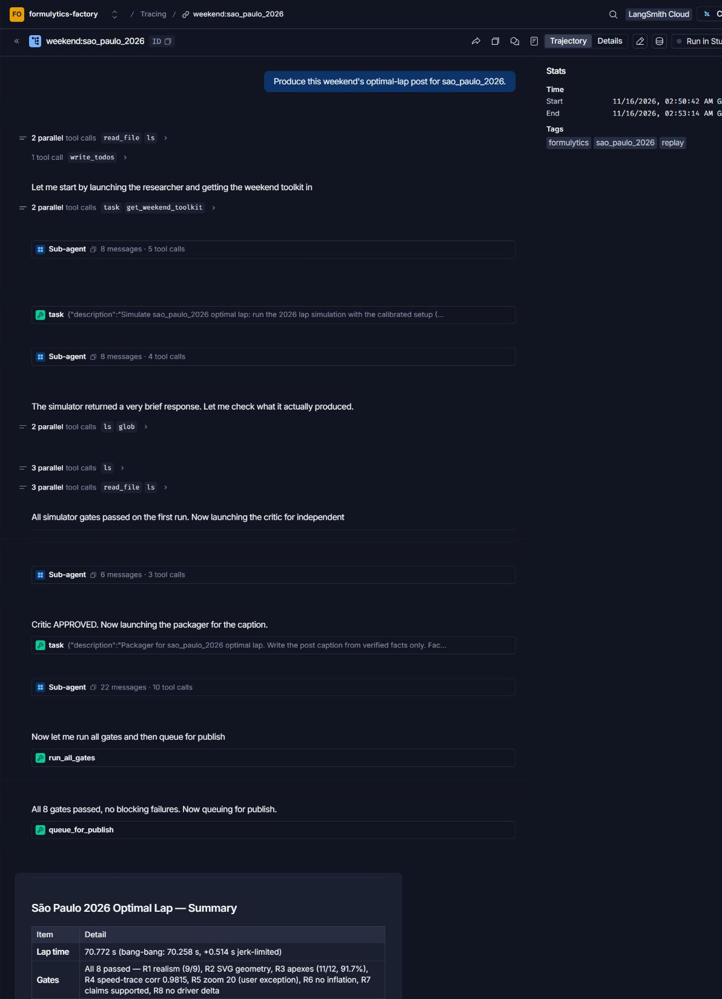

<p align="center">
  
</p>

<h1 align="center">Formulytics Content Factory</h1>

<p align="center"><b>A system that turns raw sports data into a media channel, and scores itself against reality.</b><br>
First deployment: <a href="https://www.instagram.com/formulytics/">Formulytics</a> (Formula 1): about 50K followers
across Instagram and Facebook, videos that regularly pass a million views, and a top reel at 6.8 million views.</p>

<p align="center"><b>Top three reels</b>, each the best of its format:
<a href="https://www.instagram.com/formulytics/reel/Dd96Pj0NA4T/">reel 1</a> ·
<a href="https://www.instagram.com/formulytics/reel/Da5omZXRHuT/">reel 2</a> ·
<a href="https://www.instagram.com/formulytics/reel/DZQInymS2Ce/">reel 3</a></p>

<p align="center">
  <br>
  <sub>The factory's lap-delta reconstruction (top), built from a low-rate public timing feed, next to F1's official
  ghost-car onboard (bottom). Full clip: <a href="docs/media/ghostcar_validation.mp4">ghostcar_validation.mp4</a></sub>
</p>

**In one paragraph.** An AI coding agent, given a goal and freedom, researched the F1 data sources, invented the
formats, designed the look and built a deterministic toolkit for each format. Those videos were posted to a real
channel, where they regularly reach a million views. Searching for the page, Google's AI Overview (17 Nov 2026)
describes it as *"a highly popular motorsport analytics account"* known for its optimal-lap series, qualifying
telemetry recaps and era comparisons. This repo is what I built around that agent to make the work repeatable, checkable and cheap: **the Formulytics
Retention Framework** (one part for finding a format, one for producing it every week) and a **purpose-built agent harness** that
runs them, with gates, memory, evals, tracing and cost control. Every prediction it ships is scored against what
really happened, misses included.

> **Agents make decisions. Tools make numbers. Gates make it honest.**

---

## Contents

- [The Formulytics Retention Framework](#the-formulytics-retention-framework)
- [Results](#results): predictions against reality, one full run, a caught failure, evals
- [The harness](#the-harness): orchestration, gates, memory, tracing, cost, permissions, deployment
- [Formats and new sports](#formats-and-new-sports)
- [Status](#status) · [Run it](#run-it) · [Repository map](#repository-map)

## The Formulytics Retention Framework

One framework in two parts: **Discover** finds a format worth making, **Produce** makes it every week.



| | [**Discover**](frameworks/DISCOVER.md) | [**Produce**](frameworks/PRODUCE.md) |
|---|---|---|
| **Question** | What can be shown every event that is true, that nobody shows, and that people will watch? | How do we make this week's episode accurate *and* worth watching, without drifting or going stale? |
| **Output** | A frozen format: toolkit, format grammar, gates, `SKILL.md` | A published post, plus scored predictions |
| **Key ideas** | Capability cards (what data *cannot* support), angle = viewer question + data + visual, cheap kill-probes, outside validation, freeze test | Locked base + open slots with contracts, variant library, hooks as claims, rules checked on a scene manifest *before* rendering, 3-second preview judged by a vision model |
| **Autonomy** | Steered: the owner decides at two checkpoints | L0 to L3, promoted on track record, separately for numbers and for taste |

Both parts share one core ([SHARED.md](frameworks/SHARED.md)): evidence grades, nine honesty layers, autonomy levels and
one dividing line:

> **If the rule can be written before seeing the input, it is a script. If it can only be decided after seeing the
> input, it needs a model.**

So the lap physics is a script. What makes *this* weekend's video different (a rain layer when rain is forecast, a
local touch, a focus on one driver, the hook in the first 3 seconds) can only be decided after seeing the weekend.
That small, new, judged artifact is the agentic core.

**Your rulebook, not mine.** Both parts read a creator's own rulebook: their observations about what holds
attention and what makes a format right for their channel. Mine is private and not in this repo. It is my edge, and I
reuse it across formats. The repo ships the [schema with placeholder rules](frameworks/templates/rulebook.example.yaml).
To write your own, post a first draft, watch how it does, and write each observation down as a rule with an id.
Retention rules differ from format to format, so a borrowed rulebook would not fit anyway.

**Prior art.** Most of the pieces exist elsewhere, and [SHARED.md section 7](frameworks/SHARED.md#7-prior-art-and-what-is-actually-new-here)
cites them: harness engineering, explore-then-compile, forecasting benchmarks, claim attribution, engagement
prediction. What I could not find anywhere is the combination: an agent that publishes claims to a large audience,
binds each one to evidence at publish time, is scored later against both reality and audience retention with misses
kept public, and applies the creator's own private rules before rendering. The reality half of that runs today (the
results below). The audience half is designed and not yet built ([status](#status)).

## Who owns what

| Owner | Responsibility |
|---|---|
| **The agent** | Source research, format invention, engine code, per-event decisions (what to run, re-run or reject), the weekly touch and hook, captions |
| **The harness** (this repo) | Orchestration, context, memory, gates, evals, tracing, cost control, permissions, publish queue |
| **The deterministic toolkit** | Every number and every pixel. Agents decide what to run and say, never a number |
| **The owner** | The private rulebook, the two Discover checkpoints, the pick in each review packet, pressing post |

---

## Results

### Predictions against reality

Every shipped 2026 optimal lap, scored against what happened. Real laps come from OpenF1 via
[`build_golden.py`](factory/evals/build_golden.py). A dry simulation is only compared with a dry lap.

| Weekend | Data seen before shipping | Predicted | Real | Reference | Error |
|---|---|---|---|---|---|
| **São Paulo** | none (pre-FP1) | 1:10.772 | 1:10.763 | fastest dry lap of the weekend (FP2); qualifying was wet | **+0.009 s** |
| **Mexico City** | none (pre-FP1) | 1:16.758 | 1:16.514 | qualifying pole | **+0.244 s** |
| Silverstone | FP1 | 1:27.970 | 1:28.111 | qualifying pole | −0.141 s |
| Monaco | FP1 | 1:11.770 | 1:12.051 | qualifying pole | −0.281 s |
| Madring | FP1 + FP2 | 1:32.363 | 1:31.824 | qualifying pole | +0.539 s |
| Singapore | none (pre-FP1) | 1:33.010 | 1:31.373 | qualifying pole | +1.637 s |
| Spa | none (pre-FP1) | 1:41.910 | 1:44.361 | qualifying pole | −2.451 s |
| Sepang | none, and no 2025 reference | 1:31.838 | 1:35.130 | qualifying pole | −3.292 s |
| Bahrain | none (pre-FP1) | 1:32.186 | n/a | event not held | n/a |

The early blind predictions missed by 1.6 to 3.3 s. Those misses drove the method changes (a measured
power-clipping model and an altitude correction). The two weekends since, Mexico City and São Paulo, landed within
0.25 s with no 2026 running at the track. Two weekends is a small sample, and the table will keep growing with
misses included.

### One full run: São Paulo 2026, replayed blind

The agents see no real result from that weekend. The score is computed after they finish.

| | Run 2 ([manifest](factory/runs/20261116-025039-bcad/manifest.json), [ledger](factory/runs/20261116-025039-bcad/ledger.jsonl)) |
|---|---|
| Flow | orchestrator → researcher → simulator → critic (**APPROVE**) → packager → gates → publish queue |
| Model calls | 30 (14 planner, 16 worker) |
| Cost and time | **$0.047**, 152 s |
| Lap | **1:10.772**. 9/9 engine realism checks, speed-trace correlation 0.98 against the 2025 pole trace, 11/12 apexes within 1.5 m |
| Gates | 8/8 pass |
| Score | +0.009 s against the fastest dry lap of the weekend |

### The evals caught a real failure

Run 1 ([manifest](factory/runs/20261116-024353-cbb0/manifest.json)) passed every gate, but its caption called
Interlagos a "7-corner circuit". Seven is the number of calibration corners; the track has 15 turns. The claims gate
only checked numbers with two or more digits, so the error got through. The LLM judge scored the caption 1/5 for
accuracy and named the error.

The fix: the gate now checks every number, the caption is a regression test, and the post is marked
[retracted](factory/publish/20261116-024353-cbb0/RETRACTED.md), not deleted. The same review found episodic memory
leaking run 1's real-world score to the critic. Agents no longer see post-hoc scores.

### Eval summary ([report](factory/evals/report.html), [raw](factory/evals/results.json))

| Eval | Result |
|---|---|
| Predictions vs reality | 8 weekends scored. Mean absolute error 1.07 s overall, 0.13 s on the 2 weekends since the current method |
| Engine regression (CI) | Shipped lap reproduced exactly; realism gate passes |
| Retrieval | hit@4 = 0.83; 3/3 off-topic queries withheld |
| Memory recall | 6/6 facts recovered from the knowledge graph |
| Caption judge | Run 2: hook 5, accuracy 5, clarity 4, compliance 5. Run 1: accuracy 1 |
| Unit tests | 22 pass. Every gate has a passing and a failing case |

---

## The harness

The coding agent that invented the formats ran inside a general-purpose harness (Claude Code). The `factory/`
harness replaces it for the weekly work: same kind of agent work, with my own orchestration, context, memory, gates,
evals, tracing and cost control. Each part answers a way an unattended agent goes wrong.



**Is the output right?** Eight fail-closed gates in [`gates.py`](factory/formulytics/gates.py). Nothing reaches the
publish queue unless every blocking gate passes, and a missing artifact counts as a failure. Every gate started as
feedback that came up more than once:

| Rule | Feedback | Gate |
|---|---|---|
| R1 | "2026 cars are slower than 2025; match the rate-vs-speed curve, not just peak speeds" | `realism`: lap inside the predicted band, top speed, corner minima, accel and brake rates |
| R2 | "Never use API car positions; the feed is map-matched to one path" | `no_api_xy`: geometry only from the track outline |
| R3 | "The line must touch the apexes" | `apex_touch`: 80% of corners within 1.5 m of the inside edge |
| R4 | "Use real traces, not lap-time-only fits" | `real_trace`: speed-trace correlation ≥ 0.94 against the reference |
| R5 | "Optimal-lap videos at zoom 28" | `zoom`: 28, or a per-track exception set by the owner |
| R6 | "Don't inflate the lap time" | `no_inflation`: displayed time equals simulated time |
| R7 | "No made-up numbers" | `claims_supported`: every number in the caption exists in the run's verified facts |
| R8 | "Driver comparisons use the validated delta engine" | `delta_engine` |

**What did it do?** Every run is traced in LangSmith (plan, delegations, tool calls, tokens, latency), with an
append-only [ledger](factory/runs/20261116-025039-bcad/ledger.jsonl) and a
[manifest](factory/runs/20261116-025039-bcad/manifest.json) (git SHA, models, input hashes, cost, gate results).
Any post traces back to its inputs.

<p align="center">
  <br>
  <sub>One run: the orchestrator loads the format's skill, writes its plan, delegates to four sub-agents, runs the
  gates and queues the post. 2 min 32 s, 521 traced steps.</sub>
</p>

**How does it remember?** [`memory.py`](factory/formulytics/memory.py), [`rag.py`](factory/formulytics/rag.py):
episodic (how past predictions scored), semantic (a knowledge graph of tracks and results, multi-hop recall),
procedural (the feedback rules, the memory that changes behaviour) and cited RAG over design and calibration notes,
where weak matches are withheld instead of returned. Skills load on demand, one `SKILL.md` per format, and
sub-agents return short briefs to keep the orchestrator's context small.

**What does it cost?** Routing in [`config.py`](factory/formulytics/config.py): a strong model plans and judges, a
cheap model does the work, with a fallback chain. Per-run and total budget caps stop the run
([`llm.py`](factory/formulytics/llm.py)), plus model-call and tool-call limits per agent. A full run costs **$0.047**.

**What can it touch?** Each sub-agent gets only the tools for its job ([`agents.py`](factory/formulytics/agents.py)).
Writes stay inside the run's own folder; secrets and raw data are unreadable. The simulator may change one knob at a
time inside physical bounds, with a reason, at most three times, and the critic rejects results that pass only
because a knob sits on its bound. `--approve` pauses before anything is queued. The
[MCP server](factory/formulytics/mcp_server.py) can read, simulate and check, never publish.

**How does it run?** FastAPI ([`api.py`](factory/formulytics/api.py)), Docker Compose for the API and pgvector,
GitHub Actions running unit tests and the engine regression on every push ([CI](.github/workflows/factory-ci.yml)).

---

## Formats and new sports

A format is a plug-in: a skill file, a deterministic toolkit, a format grammar, gates and evals.

| Format | The angle | Toolkit | In the harness |
|---|---|---|---|
| **Optimal lap** | The fastest physically realistic lap of each track, published **before the cars run** | Lap simulator with an energy-limited power unit, active aero, grip map and a minimum-curvature line optimiser (`OPTIMAL LAP SCRIPTS/sim_2026_lap.py`) | Yes |
| **Era comparison** | That lap against a car from another era on the same track | Era cars fitted to real telemetry, each on its own line; dual-video renderer | Skill and engine ready |
| **Driver lap comparison** | Where pole gained on P2, metre by metre | Delta engine checked against F1's ghost car (`LAP COMPARISON/hifi_delta_v2.py`) | Skill and engine ready |
| **Airflow** | Ground-effect and wing airflow on track | Vortex-lattice model (`airflow_sim_on_track/`) | In development |

The framework and the harness do not know what Formula 1 is. A new sport (cricket is planned next) runs Discover
again and brings new plug-ins:

| Carries over unchanged | New per sport |
|---|---|
| Both parts, honesty layers, autonomy levels | Data adapters and their capability cards |
| Orchestrator, sub-agent roles, delegation | Format toolkits, grammars and render styles |
| Gate framework, claims gate, fail-closed publishing | Sport-specific gates (what "realistic" means) |
| Memory, RAG, evals, tracing, ledger, budgets, API, MCP | Golden dataset, skill files, variant library |

## Status

| | Status |
|---|---|
| Discover, as a process | **Ran** for all four formats inside Claude Code, steered by the owner |
| Produce: brief, numbers, critic, gates, caption, publish queue, run records, lap scoring | **Built** in `factory/`, demonstrated on São Paulo 2026 |
| Produce: format grammar, variant library, rulebook checks, scene manifest, designer agent, 3-second preview with vision judge, owner-pick log, retention scoring | **Designed** ([PRODUCE.md](frameworks/PRODUCE.md), [templates](frameworks/templates)), not built |
| Discover inside the harness | **Designed** ([DISCOVER.md](frameworks/DISCOVER.md)), not built |
| Known gap | `agents.py` names the optimal-lap format in the orchestrator prompt; formats are not yet true plug-ins |

## Run it

```bash
cd factory
python -m venv .venv && .venv/Scripts/pip install -r requirements.txt   # harness, Python 3.11
pip install -r requirements-engine.txt                                   # engine, Python 3.10 (set ENGINE_PYTHON)
cp .env.example .env                                                     # OPENROUTER_API_KEY, LANGSMITH_API_KEY
docker compose up -d pgvector && python -m formulytics.rag ingest

python -m formulytics.run --weekend sao_paulo_2026            # full agent run
python -m formulytics.run --weekend sao_paulo_2026 --approve  # pause for human approval before queueing
python evals/run_evals.py --langsmith                         # eval suite -> evals/report.html
python -m formulytics.mcp_server                              # toolkit as an MCP server
uvicorn formulytics.api:app                                   # POST /runs
pytest -q
```

## Repository map

| Path | Contents |
|---|---|
| `frameworks/` | Discover, Produce, the shared core, and templates (rulebook, format grammar, variant, source card) |
| `factory/` | The harness: agents, skills, gates, memory, RAG, evals, API, MCP server, run records |
| `OPTIMAL LAP SCRIPTS/` | F1 toolkits: lap simulator, line optimisers, realism checks, renderers, calibration notes |
| `OPTIMAL LAP SCRIPTS/LAP COMPARISON/` | Delta engine and driver comparison |
| `airflow_sim_on_track/` | Airflow format in development |
| `optimal_lap_sandbox/` | Earlier agent workspace (Austin 2025 vs 2026) |
| `launch_control_auto_car_rig/`, `F1_Pipeline_Assets/` | Blender pipeline behind the early videos ([docs](docs/BLENDER_PIPELINE.md)) |
