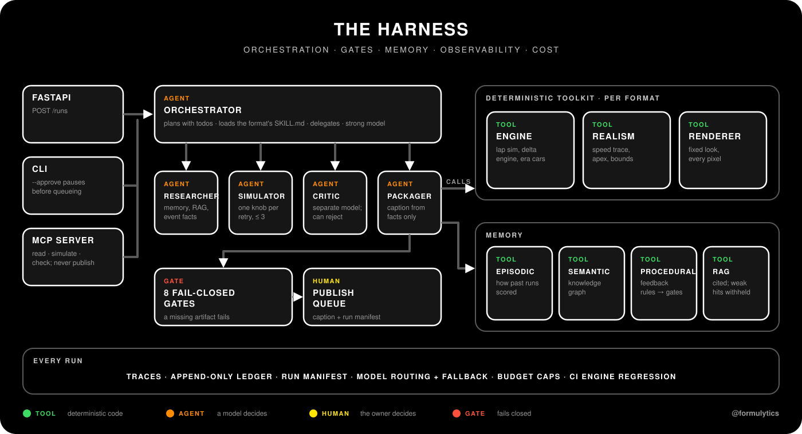

# The harness

The formats were invented by a coding agent running in a general-purpose harness (Claude Code). The `factory/`
harness replaces it for the weekly work, with its own orchestration, context, memory, gates, evals, tracing and cost
control. Each component exists because of a specific way an unattended agent goes wrong.

## Components

| Component | Responsibility | Source |
|---|---|---|
| Orchestrator | Plans with todos, loads the format's `SKILL.md`, delegates; strong model | [`agents.py`](../factory/formulytics/agents.py) |
| Researcher | Event facts, memory and cited retrieval | [`agents.py`](../factory/formulytics/agents.py), [`tools.py`](../factory/formulytics/tools.py) |
| Simulator | Runs the toolkit from its calibrated setup; one bounded knob per retry, at most three | [`engine_bridge.py`](../factory/engine_bridge.py) |
| Critic | Separate model; rejects results that pass only because a knob sits on a bound | [`agents.py`](../factory/formulytics/agents.py) |
| Packager | Writes the caption from verified facts only | [`tools.py`](../factory/formulytics/tools.py) |
| Gates | Eight fail-closed checks; a missing artifact fails | [`gates.py`](../factory/formulytics/gates.py) |
| Memory | Episodic, semantic graph, procedural rules, cited RAG | [`memory.py`](../factory/formulytics/memory.py), [`rag.py`](../factory/formulytics/rag.py) |
| Routing and budgets | Model routing with fallback, billed cost, per-run and total caps | [`config.py`](../factory/formulytics/config.py), [`llm.py`](../factory/formulytics/llm.py) |
| Run records | Append-only ledger and manifest per run | [`ledger.py`](../factory/formulytics/ledger.py) |
| Interfaces | FastAPI service, CLI with `--approve`, MCP server (read, simulate, check; never publish) | [`api.py`](../factory/formulytics/api.py), [`run.py`](../factory/formulytics/run.py), [`mcp_server.py`](../factory/formulytics/mcp_server.py) |

## Gates

Every gate began as feedback that recurred. Nothing reaches the publish queue unless every blocking gate passes, and
each gate has a passing and a failing test.

| Rule | Origin | Gate |
|---|---|---|
| R1 | 2026 cars are slower than 2025; match the rate-vs-speed curve, not only peak speeds | `realism`: lap inside the predicted band, top speed, corner minima, acceleration and braking rates |
| R2 | The public position feed is map-matched to one path | `no_api_xy`: geometry only from the track outline |
| R3 | The line must touch the apexes | `apex_touch`: 80% of corners within 1.5 m of the inside edge |
| R4 | Fit to real traces, not lap time alone | `real_trace`: speed-trace correlation ≥ 0.94 against the reference |
| R5 | House framing | `zoom`: 28, or an owner-set per-track exception |
| R6 | Never inflate the lap time | `no_inflation`: displayed time equals simulated time |
| R7 | No unsupported numbers | `claims_supported`: every number in the caption exists in the run's facts |
| R8 | Driver comparisons use the validated delta engine | `delta_engine` |

## Observability

Every run is traced (plan, delegations, tool calls, tokens, latency) and writes an append-only
ledger and a manifest ([`factory/runs/`](../factory/runs)) with git SHA, models, input hashes, knob values, gate
results and billed cost. Any post traces back to its inputs.

## Memory and context

- **Episodic:** a run log per event, so agents know how past predictions scored. Post-hoc scores are hidden from
  agents during a blind run.
- **Semantic:** a knowledge graph of tracks and results with multi-hop recall.
- **Procedural:** the feedback rules behind the gates; the memory that changes behaviour.
- **Retrieval:** pgvector over design and calibration notes. Every passage carries its source; matches below a
  calibrated threshold are withheld rather than returned.
- **Context:** skills load on demand, sub-agents return short briefs, long runs are summarised in place.

## Cost and limits

A strong model plans and judges; a cheap model does the work; a fallback chain covers provider failures. Per-run and
total budget caps stop a run, alongside model-call and tool-call limits per agent. A full run costs cents of model
spend.

## Permissions

Each sub-agent holds only the tools for its job. Writes stay inside the run's own folder; secrets and raw data are
unreadable. `--approve` pauses a run before anything is queued.

## Deployment

FastAPI service, Docker Compose for the API and pgvector, and GitHub Actions running the unit tests and the
engine regression on every push ([workflow](../.github/workflows/factory-ci.yml)).
