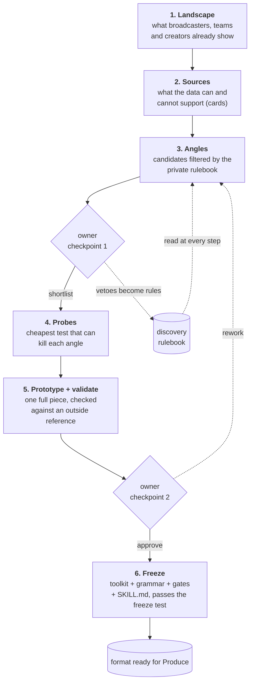

# Formulytics Retention Framework, part 1. Discover: a research framework for finding a format worth making

Discover answers one question for a sport, a channel and an audience:

> **What can be shown, every event, that is true, that nobody else shows, and that people will watch?**

Its output is not a video. It is a **frozen format**: a toolkit, a format grammar, gates and a
skill file, ready for the [Produce](PRODUCE.md) loop to run every week. It builds on the
[shared core](SHARED.md).

Discover is a steered collaboration. The agent does the reading, the probing and the building. The
owner steers at fixed checkpoints, using taste the agent does not have.

---

## 1. Why format discovery needs its own framework

General deep-research agents answer questions about the world. Format discovery has three extra
demands that they do not handle:

1. **The answer must be repeatable.** An angle that works once is a post, not a format. Every
   candidate is judged on whether it survives fifty events.
2. **The data must actually support it.** Public sports data is low-rate, map-matched, delayed and
   rate-limited. Many good-looking angles die on what the data cannot do, and that is usually found
   late. Discover finds it first.
3. **Taste is an input, not an afterthought.** What makes a format work for this audience is known
   mostly by the owner, as personal rules learned from watching their own posts. Discover reads those
   rules from the start and uses them to filter, not just to polish.

## 2. Inputs

| Input | Contents | Visibility |
|---|---|---|
| **Domain brief** | Sport, season, regulations, the calendar | Public |
| **Channel brief** | Platform, aspect ratio, length, audience size, what already performs on the page | Public |
| **Discovery rulebook** | The owner's own rules for what makes a format right for this channel: constraints on structure, pacing, data presentation, what to never do. Same schema as the [rulebook template](templates/rulebook.example.yaml), with `scope: discover` | **Private.** Loaded into context at run time, never committed, never quoted in outputs |
| **Prior formats** | Formats already frozen, with their performance | Repo |

The private rulebook matters. The rules that make a channel distinctive are its edge, and they are
also what lets the agent filter ideas the way the owner would. This repo ships the slot and the
schema, not the owner's rules. A creator using the framework writes their own: make a first draft
of the content, watch how it lands, and write down each observation as a rule with an id.

## 3. The loop

### Step 1. Landscape

Survey what already exists, so the format fills a gap instead of copying one.

| Look at | Question |
|---|---|
| Broadcaster graphics | What does the official broadcast already explain well? Where does it stop? |
| Teams and the sport's own channels | What do they publish after each event? |
| Other creators | Which formats repeat every week? What gets copied? |
| Fan discussion | What do people argue about that no graphic settles? |
| Regulations | What changed this season that people do not yet understand? |

Output: a **landscape map**, a table of who shows what, and a list of **gaps**, things people
care about that nobody shows well. Each gap is `cited`.

### Step 2. Sources

For every candidate data source, write a [capability card](templates/source_card.example.yaml):
rate, latency, access limits, trust, **supports** and **cannot support**. The `cannot support` line is
mandatory and is proved with a probe, not assumed.

The F1 example that shaped the whole project: the public car-position feed looks like real
positions, but a check showed 73 laps of one session lying within 3 cm of one path. It is
map-matched. So no format can take racing lines, track widths or corner radii from it, and every
format here builds geometry from the track outline instead. That one line on one card became the
`no_api_xy` gate.

### Step 3. Angles

Generate candidates. Each candidate is written as a triple:

> **viewer question** + **data that can answer it** + **visual that shows the answer**

Then filter and score:

| Test | Kills the angle when |
|---|---|
| **Private rulebook, hard rules** | Any hard rule fails |
| **Answerable** | The capability cards cannot support the required accuracy |
| **Repeatable** | It only works for some events |
| **Verifiable** | There is no reference to check it against, now or later |
| **Gap** | The landscape map shows someone already does it well |

Survivors are ranked on soft rules from the rulebook plus an estimated production cost per event.

**Owner checkpoint 1.** The owner sees the ranked shortlist with each angle's triple, its card
evidence and its rule results, then keeps, kills or redirects. A veto that comes with a reason is
written into the discovery rulebook as a new candidate rule, so the same idea is not proposed twice.

### Step 4. Probes

For each shortlisted angle, run the cheapest experiment that could kill it: one lap, one frame, a
5-second mock, one week of data. Each probe states in advance what result would kill the angle.

| Angle (F1) | Probe | Kill condition (example threshold) |
|---|---|---|
| Optimal lap before the cars run | Simulate one known track with last year's car and compare with last year's pole | Error above about 1% |
| Driver-vs-driver delta | Rebuild one lap delta from the public timing feed and compare with the official ghost-car graphic | Visible mismatch at any corner |
| Car from another era on today's track | Fit an older car to its real telemetry on one track | Speed-trace correlation below 0.94 |

### Step 5. Prototype and validate

Build one full piece end to end, and validate it against a reference from **outside** the system.
For the delta format, the reference was F1's own ghost-car onboard. The reconstruction, built from
the low-rate public feed, was checked frame by frame next to it
([clip](../docs/media/ghostcar_validation.mp4)).

**Owner checkpoint 2.** The owner watches the prototype like a viewer. Approve, rework the angle, or
kill. Notes from this review go into both rulebooks: discovery (was it the right format?) and
produce (what should every episode do?).

### Step 6. Freeze

A method becomes a toolkit only when it passes the **freeze test**:

1. **Reproduces history**: recreates at least *k* past cases within a stated tolerance.
2. **Deterministic**: the same inputs give the same output on a re-run.
3. **Bounded**: every knob has physical bounds and a calibration source.
4. **Gated**: every recurring rule has a gate, and every gate has a passing and a failing test.
5. **Has a grammar**: locked parts and open slots with contracts are written down
   ([template](templates/format.example.yaml)).
6. **Reviewable**: a review packet is defined.
7. **Documented**: a `SKILL.md` tells an agent how to run it in under a page.

What leaves Discover is everything [Produce](PRODUCE.md) needs and nothing more.

## 4. Outputs and records

| Output | Where |
|---|---|
| Landscape map with gaps | `discover/<sport>/landscape.md` |
| Capability cards | `sources/*.yaml` |
| Decision record: chosen angle, **rejected angles and why**, probe results | `discover/<sport>/decisions.md` |
| Toolkit, grammar, gates, tests, `SKILL.md` | `formats/<format>/` |
| New discovery rules from owner vetoes | private rulebook (not committed) |

Rejected angles are kept on purpose. They stop the same idea coming back, and they are the training
data for a better angle generator.

## 5. Evaluating discovery

Discovery is hard to score, and the number of formats is small, so these metrics are reported
honestly rather than as benchmarks:

| Metric | Meaning |
|---|---|
| **Shortlist acceptance** | Share of proposed angles the owner keeps at checkpoint 1 |
| **Card accuracy** | Number of `cannot support` limits found *after* freezing (should be zero) |
| **Probe kill rate** | Share of angles killed by a cheap probe rather than after a prototype |
| **Time to freeze** | Days from first landscape to a frozen toolkit |
| **Format outcome** | The format's median retention over its first 10 posts, against the channel median |

## 6. Status in this repo

| Part | Status |
|---|---|
| The loop itself | **Ran** for the optimal-lap, era-comparison, driver-delta and airflow formats, inside a general-purpose coding agent (Claude Code), with the owner steering |
| Capability-card findings | Exist as rules and gates (`no_api_xy`), and in calibration notes; not yet as card files |
| Decision records | In calibration and bring-up notes under `OPTIMAL LAP SCRIPTS/cache/`; not yet in this layout |
| Discover inside the `factory/` harness | **Designed** (this document); not built |
