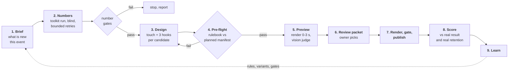

# Formulytics Retention Framework, part 2. Produce: a framework for making the same format every week, honestly, with a fresh touch

Produce runs a frozen format (from [Discover](DISCOVER.md)) on each new event. It has two jobs,
and both are scored afterwards against reality:

1. **Get every number right.** Deterministic tools, blind calibration, fail-closed gates.
2. **Make this week's episode worth watching.** The base stays fixed. One small, new, judged touch
   is added for this event, and the opening seconds are checked against the owner's retention rules
   **before** anything is rendered in full.

It builds on the [shared core](SHARED.md): the script-or-model line, evidence grades, honesty layers
and autonomy levels.

---

## 1. The problem it solves

A weekly format faces two opposite failures:

- **Drift.** Every episode is improvised, so quality, look and accuracy wander. Fixed by freezing:
  the engine, layout, palette, motion and every number are locked.
- **Staleness.** Every episode is identical, so the audience stops watching. Fixed by a controlled
  amount of novelty: a few **open slots**, each with a contract, filled differently each week.

Today a creator's retention insights can only be applied after a post's results come in. Produce
applies them before rendering, as checks on a plan, and then scores whether they were right.

## 2. The weekly loop



| Step | Who does it | Script or model? | Output |
|---|---|---|---|
| 1. Brief | researcher agent | Model: what matters this week depends on this week | 3 to 5 candidate touches, each with a reason and a source |
| 2. Numbers | simulator agent + toolkit | Script; the model only picks the next run and states why | Facts, graded |
| 3. Design | designer agent | Model | Storyboard per candidate, 3 hook variants each |
| 4. Pre-flight | rule checks | Script (manifest rules) | Pass or fail per rule, on the plan |
| 5. Preview | renderer + vision judge | Script renders, model judges | Scores with quoted reasons |
| 6. Review packet | owner | Human | The pick, recorded |
| 7. Render and publish | renderer + gates | Script | Post, manifest, ledger |
| 8. Score | evals | Script | Prediction error, retention vs prediction |
| 9. Learn | critic agent + owner | Model proposes, human approves | New rules, variants, gates, tests |

### Step 1. Brief

The researcher returns what is different about this event, each item `cited`:

- **Conditions:** forecast and observed weather per session.
- **Place:** local culture, holidays and events that weekend.
- **Story:** title fight, home race, rookie, records within reach, a driver's milestone.
- **Track:** layout facts, what changed since last year.

It ends with 3 to 5 **candidate touches**, each naming an open slot, an existing variant from the
library or a proposed new one, and the reason. Example: rain forecast for qualifying, so propose the
`rain_filter` variant for `weather_layer`, with the reason and the forecast source.

### Step 2. Numbers

The toolkit runs blind before the event, from its calibrated setup. Agents may change one knob at a
time, inside physical bounds, with a stated reason, at most three times. A critic that did not run
the engine judges the result. Every number that leaves this step is a Fact. This step is unchanged
from the current harness ([`factory/`](../factory)).

### Step 3. Design

The designer fills the **open slots** of the [format grammar](templates/format.example.yaml) and
nothing else. Locked parts (engine, layout, palette, motion, branding, numbers) are out of reach.

- **Touch.** Reuse a variant from the library, or author a new one. A new one is marked
  `proposed` and always escalates to the owner.
- **Hooks.** Three hook variants per candidate, from a catalogue of hook patterns (contrast with a
  known number, a reveal, a question, a stakes line). Each hook is a claim: it passes the claims gate
  like a caption does.

Output: a **plan** per candidate, which is a storyboard plus a **planned scene manifest**.

### Step 4. Pre-flight: check the plan before rendering

Because the videos are generated, not filmed, the renderer knows exactly what it will draw. It can
write a **scene manifest**: per frame, every element with id, type, bounding box, z-order, visible
text and motion since the last frame, plus the time of the first data reveal.

```json
{"t": 0.40, "elements": [
  {"id": "hook_card", "type": "text", "bbox": [64, 210, 1016, 330], "z": 9,
   "text": "<hook line>", "text_px": 58, "motion_px": 0},
  {"id": "car", "type": "sprite", "bbox": [498, 1102, 582, 1160], "z": 5, "motion_px": 31}
]}
```

Every rule in the rulebook with `checked_by: manifest` runs against the planned manifest, with no
render and no model. Such rules can check readable text size, what moves in a time window, whether a
prop covers data, slot screen-area limits and time to first reveal. A failed hard rule sends the plan
back to Design with the reason.

### Step 5. Preview: watch it like the owner

Render only the first 3 seconds of each surviving plan, plus one mid-video frame. A vision-language
model judges the sampled frames against the rulebook's `checked_by: vlm` rules: legible on a phone,
too busy, does the hook make a promise, does the touch imply anything false. It returns a score per
rule **with a quoted reason**, saved to the run.

### Step 6. Review packet

The owner gets, per variant: the 0 to 3 s preview as a GIF, the mid frame, the hook text, the
pre-flight and judge results, and the number facts. The owner picks one, or rejects all. **The pick
is recorded** together with the judge's own pick. That pair is the agreement dataset (section 7).

### Steps 7 to 9. Render, score, learn

Full render, all blocking gates, publish. After the event and after the post has been live long
enough, scoring runs on both truths:

| Score | Against |
|---|---|
| Lap prediction error | The real lap: qualifying pole, or fastest dry lap if qualifying was wet |
| Retention prediction error | The post's real 3-second hold and average watch time |
| Variant performance | Retention of posts with this touch against the format median |
| Rule track record | Retention of posts that followed each rule against those that broke it |

Learning: a recurring correction becomes a rule, then a gate, then a test. A miss against the real
result becomes a logged method change. A failure that got through becomes a regression test, and the
post is marked retracted, not deleted. An approved new touch joins the variant library.

## 3. Format grammar

| Part | Contents | Who may change it |
|---|---|---|
| **Locked** | Engine, layout, palette, motion timing, branding, every number | Nobody during Produce. A change is a new format version, via Discover |
| **Open slots** | Weather layer, prop on car, driver focus, hook card, caption, camera emphasis, music cue | The designer, within each slot's contract |
| **Contracts** | Per slot: max screen area, what it may never cover, what it may never change or imply, which gate checks it | The owner |

Example contract: a prop may use at most 3% of the screen, may never cover data, and may never
change a number. The full grammar for the optimal-lap format is in the
[template](templates/format.example.yaml).

## 4. Variant library

Every touch ever used is a reusable component ([template](templates/variant.example.yaml)): which
slot it fills, its trigger, what it must never imply, its status (`proposed`, `approved`, `retired`)
and its appearances with the retention of each post. Each week the designer either reuses one whose
trigger fires, or authors a new one. Only the owner approves a new one into the library.

Over a season this turns one-off creative ideas into a scored catalogue: which touches hold
attention, and which only felt good.

## 5. The rulebook: the owner's taste, made checkable

The rulebook holds the owner's observations about what holds attention for this channel
([schema and placeholder examples](templates/rulebook.example.yaml)).

| Field | Meaning |
|---|---|
| `id`, `insight` | The observation, in the owner's words |
| `kind` | `hard` blocks a plan, `soft` lowers its score, `note` is shown to the reviewer only |
| `applies_to` | Time window and screen region |
| `checked_by` | `manifest`, `vlm`, `learned` or `human` |
| `learned_from` | The post that taught it |
| `track_record` | Retention when followed against when broken, filled by Score |

**Private by design.** The rulebook is the creator's edge and is reused across future formats, so it
is gitignored and loaded only at run time. This repo ships the schema and placeholder rules. Every
creator writes their own, because what holds attention differs by format and by audience: make a
first draft, post it, watch how it does, and write each observation down as a rule.

**Promotion.** Every rule starts as `human`. It moves to `manifest` or `vlm` only when it has a check
and a passing and failing test case, the same standard as the publishing gates. A `vlm` rule's
judgments are tracked against the owner's, and a rule whose judge disagrees too often goes back to
`human`.

## 6. Three ways to show the agent the video

| Layer | Gives | Tool | When | Cost |
|---|---|---|---|---|
| **1. Scene manifest** | Exactly what is where and when, per frame | The renderer logs what it draws | On the plan, before rendering | Free, exact |
| **2. Vision judge** | Perception: legibility, clutter, would it stop the scroll | Vision-language model on sampled preview frames, prompted with the `vlm` rules | On the 3-second preview | Cents per variant |
| **3. Learned taste** | "Videos like this held attention on this channel" | A frozen video encoder (for example V-JEPA 2) producing embeddings, plus a small read-out trained on this channel's retention | Once enough posts have retention labels | One-off training |

Layer 3 is last on purpose. A video encoder outputs embeddings, not judgments or reasons, and it
cannot read the rulebook. It learns only from this channel's own history, so it needs many labelled
posts, and its held-out error is reported before it is allowed to influence a pick.

## 7. Evaluating taste

| Eval | How | Drives |
|---|---|---|
| **Judge-owner agreement** | Pairwise: for each review packet, did the judge pick what the owner picked? | Taste autonomy: L1 to L2 only above a set agreement rate |
| **Retention prediction** | The judge predicts each variant's 3-second hold before posting; scored after | Trust in the judge; the honesty record |
| **Rule track record** | Retention when a rule is followed vs broken | Which rules stay `hard` |

Hold rate and average watch time are used, not views, because views mostly measure distribution.
Retention numbers come from the platforms' creator insights: exported where possible, otherwise read
from insight screenshots by a vision model into `retention.jsonl`, with each row linked to its run
manifest and checked by hand on a sample. Small samples are noisy, so results are reported with the
number of posts behind them.

## 8. Contracts

```text
formats/<format>/
  format.yaml            # grammar: locked, open slots, contracts, gates, review packet, autonomy
  SKILL.md               # how an agent runs it
  gates.py, tests/       # a passing and a failing case per gate
variants/<variant>/      # variant.yaml, component.py, preview.gif
taste/
  rulebook.private.yaml  # gitignored: the owner's rules
  rule_checks.py         # one function per manifest-checkable rule, with tests
  hooks.yaml             # hook-pattern catalogue
runs/<run_id>/
  manifest.json          # git SHA, models, input hashes, knobs, gate results, cost
  ledger.jsonl           # every model and tool call
  facts.json             # every number, with tool and grade
  plan_<variant>.json    # storyboard + planned scene manifest
  preview/, judge.json   # 0-3 s previews and the vision judge's scores
  pick.json              # owner pick vs judge pick
evals/
  golden.json            # lap predictions vs real results
  retention.jsonl        # per-post retention, linked to runs
```

## 9. Status in this repo

| Part | Status |
|---|---|
| Brief, Numbers, critic, gates, packaging, publish queue, run records | **Built** in [`factory/`](../factory), run on São Paulo 2026 |
| Lap-prediction scoring with misses public | **Built**: [`factory/evals/`](../factory/evals), 8 weekends scored |
| Claims gate on captions | **Built**; extends to hook cards once Design exists |
| Format grammar, variant library, rulebook, rule checks | **Designed**, templates in [`templates/`](templates) |
| Scene manifest from the renderers | **Designed** |
| Designer agent, hook catalogue, preview + vision judge, review-packet pick log | **Designed** |
| Retention ingestion and taste evals | **Designed**; per-post retention to come from platform insights |
| Learned-taste layer (video encoder + read-out) | **Designed**; needs enough labelled posts first |
| Orchestrator decoupled from one format | **Not yet**: `agents.py` names the optimal-lap format in its prompt |
